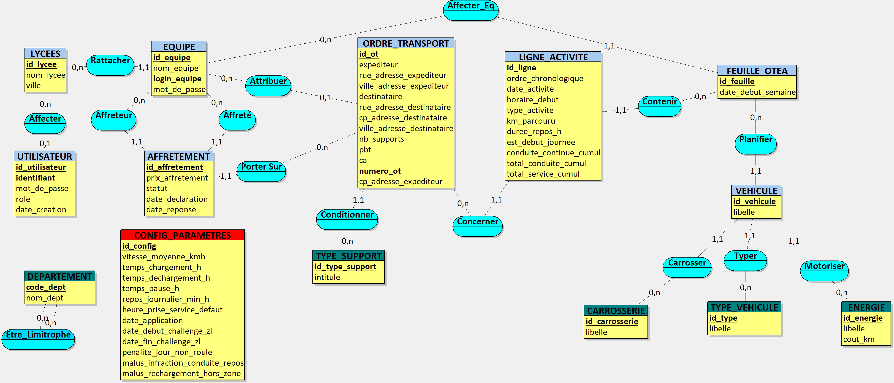

# Documentation de la Base de Données - Challenge GTLA

Ce dossier regroupe l'ensemble des livrables de la **Mission 3 : Documenter la base de données** du stage BTS SIO, réalisée par rétro-conception du script SQL `bdd/challenge_gtla.sql`.

---

## 📁 Sommaire des Livrables

| Fichier | Format | Description |
|---|---|---|
| **[`mcd.png`](mcd.png)** | Image PNG HD | Export graphique du **Modèle Conceptuel de Données (MCD)** conforme à la méthode Merise (entités, attributs, identifiants, associations, cardinalités, association réflexive et table singleton). |
| **[`mld.md`](mld.md)** | Markdown | **Modèle Logique de Données (schéma relationnel)** textuel avec clés primaires soulignées (`<u>PK</u>`) et clés étrangères suivies de `#` (`FK#`), complété par l'analyse comparative entre MLD théorique et script physique. |
| **[`dictionnaire.md`](dictionnaire.md)** | Markdown | **Dictionnaire des données exhaustif** couvrant les 15 tables et 78 colonnes (nom, type, nullabilité, contraintes PK/FK/UNIQUE/DEFAULT, description métier). |
| **[`regles-de-gestion.md`](regles-de-gestion.md)** | Markdown | **Règles de gestion numérotées** (RG01 à RG37) justifiant chaque cardinalité, association et contrainte d'intégrité à partir des règles métier du challenge. |
| **[`issues-anomalies-bdd.md`](issues-anomalies-bdd.md)** | Markdown | **Fiches d'anomalies repérées** sur le schéma initial, prêtes à être ouvertes sous forme d'issues GitHub étiquetées `zone:bdd`. |
| **[`schema_ddl.sql`](schema_ddl.sql)** | Script SQL | Script DDL purifié (tables, index, clés étrangères, sans les données de démo) utilisé pour la rétro-conception. |
| **[`challenge_gtla.loo`](challenge_gtla.loo)** | Modèle Looping | Fichier projet pour le logiciel de modélisation Merise **Looping**. |

---

## 📊 Aperçu du Modèle Conceptuel de Données (MCD)

Le MCD a été modélisé selon la méthode Merise à partir des 15 tables de la base :
- **5 tables de référence** : `ref_types_vehicule`, `ref_carrosseries`, `ref_energies`, `ref_departements`, `zl_types_supports`
- **7 entités métier** : `lycees`, `equipes`, `utilisateurs`, `zl_vehicules`, `zl_ordres_transport`, `zl_feuilles_otea`, `zl_lignes_activite`
- **2 entités/tables d'association** :
  - `zl_affretements` : reliant un OT à deux équipes distinctes (affréteur et affrété via deux associations distinctes).
  - `zl_departements_limitrophes` : association réflexive N:N sur les départements.
- **1 table isolée** : `zl_config_parametres` (singleton de configuration globale du challenge).

---

## 🛠️ Utilisation avec le logiciel Looping

Le logiciel portable Looping pour Windows est disponible dans `tools/looping/Looping.exe`.

Pour visualiser ou réexporter le modèle :
1. Lancez `tools/looping/Looping.exe` (exécutable portable, aucune installation requise).
2. Pour régénérer le modèle automatiquement : cliquez sur le bouton **Rétroconception** dans le ruban et chargez le fichier `docs/bdd/schema_ddl.sql`.
3. Pour exporter le MLD ou l'image : utilisez le menu **Fichier > Exporter**.
